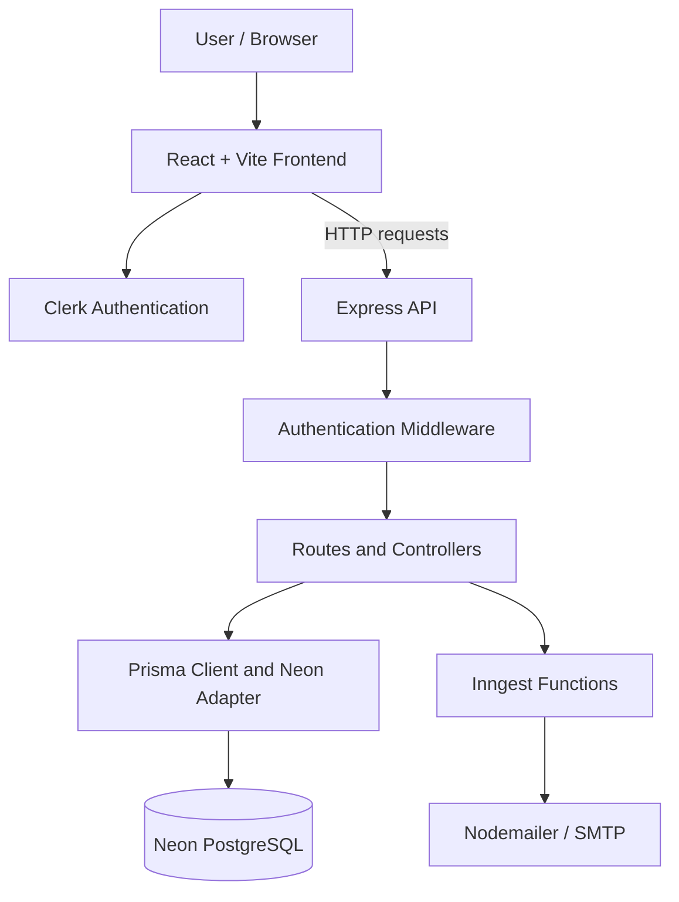
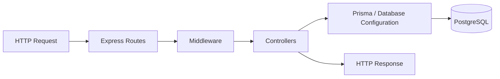
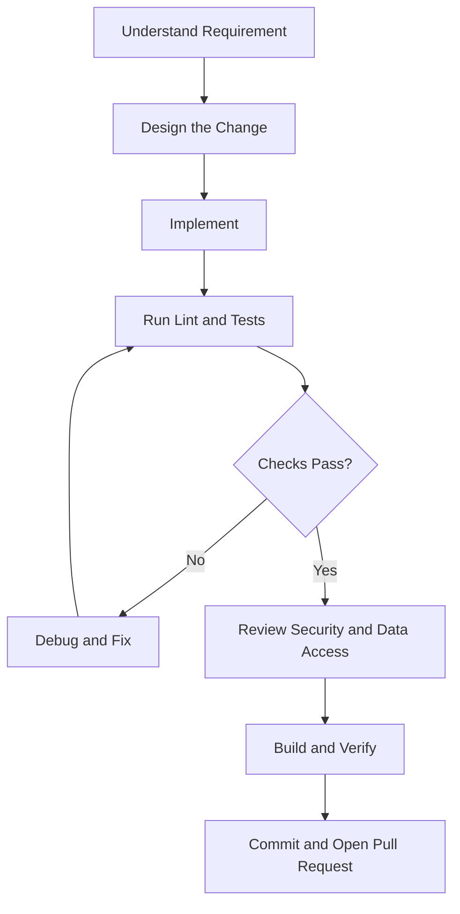

<div align="center">

# Project Management System

## Full-Stack Project Management System: PMS

**A full-stack workspace for organizing projects, coordinating teams, and tracking tasks.**

A web application built with React, Express, Clerk authentication, Prisma, and PostgreSQL.

[](https://react.dev/)
[](https://vite.dev/)
[](https://tailwindcss.com/)
[](https://nodejs.org/)
[](https://expressjs.com/)
[](https://www.prisma.io/)
[](https://neon.tech/)
[](https://clerk.com/)
[](LICENSE)

</div>

---

## Table of Contents

- [Overview](#overview)
- [Project Goals](#project-goals)
- [Features](#features)
- [Technology Stack](#technology-stack)
- [System Architecture](#system-architecture)
- [Repository Structure](#repository-structure)
- [Prerequisites](#prerequisites)
- [Getting Started](#getting-started)
- [Environment Configuration](#environment-configuration)
- [Running the Application](#running-the-application)
- [Database and Prisma](#database-and-prisma)
- [Application Modules](#application-modules)
- [API Overview](#api-overview)
- [Authentication and Security](#authentication-and-security)
- [Background Jobs and Email](#background-jobs-and-email)
- [Development Workflow](#development-workflow)
- [Build, Lint, and Production](#build-lint-and-production)
- [Deployment](#deployment)
- [Troubleshooting](#troubleshooting)
- [Roadmap](#roadmap)
- [Contributing](#contributing)
- [License](#license)

## Overview

The **Project Management System** is a full-stack web application intended to bring project organization and team task coordination into one workspace. It combines a React-based frontend with an Express API and a PostgreSQL database accessed through Prisma.

The repository is organized into two primary applications:

- **`client/`** — the browser application, built with React and Vite. It contains the user interface, navigation, workspace and project views, task-management screens, analytics, and client-side state management.
- **`server/`** — the backend application, built with Node.js and Express. It contains API routes, controllers, authentication middleware, database configuration, Prisma schema, email configuration, and Inngest functions.

Clerk provides the authentication integration. Neon hosts the PostgreSQL database. Inngest is included for event-driven/background workflows, and Nodemailer is configured for SMTP email delivery.

This README documents the structure and setup supported by the repository. Features and endpoint behavior should be confirmed against the implementation before treating them as a production contract.

---

# 👨‍💻 About Me

Hi, I'm **Satinder Singh Sall**, a Full-Stack Developer, AI Enthusiast, and MCA student passionate about building scalable digital products, intelligent software systems, and meaningful user experiences.

My journey spans across **Web Development, Mobile Applications, Artificial Intelligence, Cloud Technologies, and Creative Writing**. I enjoy transforming ideas into production-ready solutions using modern technologies while continuously exploring emerging fields like Machine Learning, Computer Vision, and Automation.

Currently, I'm pursuing my **Master of Computer Applications (MCA)** while actively developing full-stack applications, AI-powered solutions, and open-source learning resources. My work focuses on creating software that is not only functional but also scalable, maintainable, and impactful.

## 🚀 What I'm Building

- 🤖 AI-Powered Attendance System using Face Recognition & Voice Biometrics
- 🌐 Modern Full-Stack Web Applications
- 📱 Cross-Platform Mobile Applications
- 🎮 Exploring Game Development & Interactive Experiences
- 📚 Open-Source Learning Roadmaps and Technical Resources
- ✍️ Satinder Poetry — A platform for original poetry, essays, and creative writing

## 🛠️ Core Technologies

**Frontend:** React, Next.js, TypeScript, Tailwind CSS
**Backend:** Node.js, Express.js, REST APIs
**Databases:** MongoDB, PostgreSQL, MySQL, Firebase, Supabase
**DevOps & Cloud:** Docker, GitHub Actions, Vercel, Render
**Programming:** Python, Java, JavaScript, C++, C#, Kotlin
**AI / ML:** Python, Computer Vision, Face Recognition, Automation
**Mobile Apps:** High-Performance Android, iOS, Cross-Platform & Native Development

## 🌍 Connect With Me

🌐 Portfolio: https://satinder-portfolio.vercel.app

💻 GitHub: https://github.com/SatinderSinghSall

💼 LinkedIn: https://www.linkedin.com/in/satinder-singh-sall-b62049204/

🎥 YouTube: https://www.youtube.com/@satindersinghsall.3841

✍️ Satinder Poetry: https://satinderpoetry.com

🤖 AI Attendance Project: https://ai-attendance-app-satinder.vercel.app/

---

> _"I believe great software is built at the intersection of engineering excellence, continuous learning, creativity, and real-world problem solving."_

⭐ Always learning. Always building. Always improving.

---

## Project Goals

- Organize work around projects, workspaces, team members, and tasks.
- Provide a central dashboard for project and task information.
- Support project and task creation through dedicated dialogs.
- Present project details, task details, calendars, and analytics in a unified interface.
- Integrate authentication and protected backend access.
- Persist application data in PostgreSQL through Prisma.
- Provide a foundation for email notifications and background processing.
- Maintain a clear separation between frontend presentation and backend business logic.

## Features

The component and page structure indicates support for the following application areas:

| Area                  | Included UI or backend modules                                                                                                        |
| --------------------- | ------------------------------------------------------------------------------------------------------------------------------------- |
| Dashboard             | `Dashboard.jsx`, `StatsGrid.jsx`, `TasksSummary.jsx`, `RecentActivity.jsx`                                                            |
| Projects              | `Projects.jsx`, `ProjectCard.jsx`, `CreateProjectDialog.jsx`                                                                          |
| Project details       | `ProjectDetails.jsx`, `ProjectOverview.jsx`, `ProjectTasks.jsx`, `ProjectCalendar.jsx`, `ProjectAnalytics.jsx`, `ProjectSettings.jsx` |
| Tasks                 | `TaskDetails.jsx`, `CreateTaskDialog.jsx`, `MyTasksSidebar.jsx`                                                                       |
| Workspace             | `WorkspaceDropdown.jsx`, `workspaceSlice.js`, `workspaceController.js`                                                                |
| Team and membership   | `Team.jsx`, `InviteMemberDialog.jsx`, `AddProjectMember.jsx`                                                                          |
| Authentication        | Clerk integration and `authMiddleware.js`                                                                                             |
| Backend API           | Express routes and controllers for workspaces, projects, tasks, and comments                                                          |
| Persistence           | Prisma ORM with Neon PostgreSQL                                                                                                       |
| Background processing | Inngest integration                                                                                                                   |
| Email                 | Nodemailer SMTP configuration                                                                                                         |
| User interface        | React, Tailwind CSS, Lucide icons, toast notifications, and Recharts                                                                  |

The table describes the modules present in the supplied project structure; it does not imply that every possible workflow, permission rule, or notification is fully implemented.

## Technology Stack

### Frontend

| Technology          | Role                                    |
| ------------------- | --------------------------------------- |
| React 19            | Component-based user interface          |
| Vite 7              | Development server and production build |
| Tailwind CSS 4      | Utility-first styling                   |
| `@tailwindcss/vite` | Tailwind integration with Vite          |
| React Router 7      | Client-side navigation                  |
| Redux Toolkit       | Application state management            |
| React Redux         | React bindings for Redux                |
| Clerk React         | Frontend authentication integration     |
| Axios               | HTTP requests to the backend            |
| Recharts            | Data visualization and charts           |
| `date-fns`          | Date formatting and manipulation        |
| Lucide React        | Icons                                   |
| React Hot Toast     | Toast notifications                     |
| ESLint              | Static code checks                      |

### Backend

| Technology                 | Role                                            |
| -------------------------- | ----------------------------------------------- |
| Node.js                    | JavaScript runtime                              |
| Express 5                  | HTTP API framework                              |
| Clerk Express              | Authentication integration for Express          |
| Prisma 6                   | Database ORM and client generation              |
| Neon Serverless PostgreSQL | Hosted relational database                      |
| `@prisma/adapter-neon`     | Neon database adapter for Prisma                |
| Inngest                    | Event-driven functions and background workflows |
| Nodemailer                 | SMTP email delivery                             |
| `dotenv`                   | Environment variable loading                    |
| CORS                       | Cross-origin request configuration              |
| Multer                     | Multipart/form-data handling                    |
| `ws`                       | WebSocket implementation dependency             |
| Nodemon                    | Backend development auto-restart                |

### Infrastructure and services

- **Authentication:** [Clerk](https://clerk.com/)
- **Database hosting:** [Neon](https://neon.tech/)
- **Background jobs:** [Inngest](https://www.inngest.com/)
- **Email delivery:** SMTP configured through Nodemailer; the provided configuration is compatible with services such as [Brevo](https://www.brevo.com/).
- **Frontend deployment:** Vercel configuration is present in `client/vercel.json`.
- **Backend deployment:** Vercel configuration is present in `server/vercel.json`.

The existence of deployment configuration files does not by itself guarantee that production deployment is configured correctly.

## System Architecture

### High-level architecture



### Request lifecycle

1. A user interacts with a page or component in the React application.
2. The frontend uses the configured API base URL to make an HTTP request.
3. Express receives the request and routes it to the appropriate route handler.
4. Authentication middleware validates the request where protection is required.
5. A controller applies application logic and uses Prisma to access PostgreSQL.
6. The server returns an HTTP response, which the frontend uses to update the UI.
7. Where configured, event-driven workflows can process background work and email can be sent through SMTP.

The exact sequence depends on the endpoint and implementation. Do not assume every route is protected or every operation triggers an Inngest event without checking the code.

### Backend layering



### Architectural responsibilities

- **Pages:** Compose the main screens and page-level behavior.
- **Components:** Encapsulate reusable UI elements and dialogs.
- **Redux slices:** Store shared frontend state, such as theme and workspace state.
- **API configuration:** Centralizes frontend API settings in `client/src/configs/api.js`.
- **Routes:** Map HTTP paths and methods to backend handlers.
- **Controllers:** Implement request handling and business operations.
- **Middleware:** Applies cross-cutting concerns, including authentication.
- **Prisma schema:** Defines the database model used by Prisma.
- **Integrations:** Connect the backend to Clerk, Neon, Inngest, and SMTP.

## Repository Structure

```text
Project Management/
├── .gitignore
├── README.md
├── client/
│   ├── public/
│   ├── src/
│   │   ├── app/
│   │   │   └── store.js
│   │   ├── assets/
│   │   ├── components/
│   │   ├── configs/
│   │   │   └── api.js
│   │   ├── features/
│   │   │   ├── themeSlice.js
│   │   │   └── workspaceSlice.js
│   │   ├── pages/
│   │   ├── App.jsx
│   │   ├── index.css
│   │   └── main.jsx
│   ├── .env.example
│   ├── .gitignore
│   ├── package.json
│   ├── vite.config.js
│   └── vercel.json
├── server/
│   ├── configs/
│   │   ├── nodemailer.js
│   │   └── prisma.js
│   ├── controllers/
│   │   ├── commentController.js
│   │   ├── projectController.js
│   │   ├── taskController.js
│   │   └── workspaceController.js
│   ├── inngest/
│   │   └── index.js
│   ├── middlewares/
│   │   └── authMiddleware.js
│   ├── prisma/
│   │   └── schema.prisma
│   ├── routes/
│   │   ├── commentRoutes.js
│   │   ├── projectRoutes.js
│   │   ├── taskRoutes.js
│   │   └── workspaceRoutes.js
│   ├── .env.example
│   ├── package.json
│   ├── server.js
│   └── vercel.json
└── doc/
    └── How to Setup & Run Project.pdf
```

Some files, including lockfiles and additional configuration files, are omitted from this illustrative tree for readability. The `doc/` directory contains a project setup PDF.

## Prerequisites

Install the following before running the project:

- **Node.js:** Use a current Node.js LTS version compatible with the installed dependencies.
- **npm:** Included with Node.js; use the lockfiles for reproducible installation.
- **Git:** For version control.
- **Clerk account:** To configure authentication keys.
- **Neon account:** To create a PostgreSQL database and obtain pooled and direct connection URLs.
- **Inngest account or local development setup:** If you intend to run the background functions.
- **SMTP credentials:** Required for testing email delivery.

Check your installed versions:

```bash
node --version
npm --version
git --version
```

## Getting Started

### 1. Clone the repository

Replace the example URL with the actual URL of your GitHub repository.

```bash
git clone https://github.com/YOUR_USERNAME/YOUR_REPOSITORY.git
cd YOUR_REPOSITORY
```

### 2. Install frontend dependencies

```bash
cd client
npm install
```

### 3. Configure the frontend environment

Create a local environment file from the example:

```bash
# Run from the client directory
cp .env.example .env
```

On Windows Command Prompt, you can use:

```bat
copy .env.example .env
```

Set the values described in [Environment Configuration](#environment-configuration).

### 4. Install backend dependencies

Open a second terminal from the repository root:

```bash
cd server
npm install
```

The backend package defines a `postinstall` script that runs Prisma Client generation. If generation does not complete successfully, check the Prisma configuration and run the generation command manually.

### 5. Configure the backend environment

Create the backend environment file:

```bash
# Run from the server directory
cp .env.example .env
```

On Windows Command Prompt:

```bat
copy .env.example .env
```

Fill in the actual credentials locally. Never commit `.env`.

### 6. Prepare the database

Review `server/prisma/schema.prisma` and verify that the Neon connection strings are correct. Generate the Prisma Client:

```bash
cd server
npx prisma generate
```

If the schema contains new models or changes that need to be applied to the database, use the migration workflow appropriate to the project. For a development database without an existing migration history, `npx prisma db push` can synchronize the schema; for a team or production workflow, prefer reviewed Prisma migrations.

```bash
# Development convenience only; review the schema before running
npx prisma db push
```

Do not run schema-changing commands against a production database without reviewing the expected changes and creating a recovery plan.

### 7. Start the backend

From `server/`:

```bash
npm run server
```

The supplied script runs `nodemon server.js`. The actual port is determined by the server implementation and environment configuration; the frontend example below assumes the API listens on port `5000`.

### 8. Start the frontend

From `client/`, in another terminal:

```bash
npm run dev
```

Open the local URL printed by Vite, typically `http://localhost:5173`.

> **Important:** Ensure `VITE_BASEURL` matches the address at which the backend is actually listening. If the backend uses a different port, update the frontend environment variable accordingly.

## Environment Configuration

The application uses separate environment files for the client and server.

### Frontend: `client/.env`

```dotenv
VITE_CLERK_PUBLISHABLE_KEY=your_clerk_publishable_key
VITE_BASEURL=http://localhost:5000
```

| Variable                     | Purpose                                         |
| ---------------------------- | ----------------------------------------------- |
| `VITE_CLERK_PUBLISHABLE_KEY` | Clerk publishable key used by the frontend      |
| `VITE_BASEURL`               | Base URL used by the frontend API configuration |

**Vite security note:** Any variable prefixed with `VITE_` may be included in the browser bundle. Only place public configuration values there. Never put a Clerk secret key, database URL, SMTP password, or other server secret in a `VITE_` variable.

### Backend: `server/.env`

```dotenv
NODE_ENV=development

# Clerk
CLERK_PUBLISHABLE_KEY=your_clerk_publishable_key
CLERK_SECRET_KEY=your_clerk_secret_key

# Neon PostgreSQL
DATABASE_URL=your_neon_pooled_connection_url
DIRECT_URL=your_neon_direct_connection_url

# Inngest
INNGEST_EVENT_KEY=your_inngest_event_key
INNGEST_SIGNING_KEY=your_inngest_signing_key

# SMTP / email
SENDER_EMAIL=your_sender_email
SMTP_USER=your_smtp_username
SMTP_PASS=your_smtp_password
```

| Variable                | Purpose                                                                                    |
| ----------------------- | ------------------------------------------------------------------------------------------ |
| `NODE_ENV`              | Runtime environment, such as `development` or `production`                                 |
| `CLERK_PUBLISHABLE_KEY` | Public Clerk application key used by backend configuration where needed                    |
| `CLERK_SECRET_KEY`      | Secret key for server-side Clerk integration                                               |
| `DATABASE_URL`          | Pooled Neon connection string, if configured for pooling                                   |
| `DIRECT_URL`            | Direct database connection string, if required by the Prisma schema or deployment workflow |
| `INNGEST_EVENT_KEY`     | Inngest event key for the configured integration                                           |
| `INNGEST_SIGNING_KEY`   | Inngest signing key used for request verification                                          |
| `SENDER_EMAIL`          | Sender address used by the mailer                                                          |
| `SMTP_USER`             | SMTP username                                                                              |
| `SMTP_PASS`             | SMTP password                                                                              |

Use the variable names expected by the existing code. For example, check `server/configs/prisma.js`, `server/configs/nodemailer.js`, `server/server.js`, and `server/prisma/schema.prisma` before renaming environment variables.

For Neon, copy the correct connection strings from your Neon project. The exact use of pooled and direct URLs depends on the Prisma datasource and adapter configuration in this repository.

### Environment file rules

- Keep `client/.env` and `server/.env` local.
- Commit sanitized `.env.example` files containing placeholders only.
- Rotate any credential that has been exposed in a public repository or log.
- Configure production secrets through the deployment platform's environment settings.
- Restart the Vite development server after changing frontend environment variables.

## Running the Application

### Frontend commands

Run these from `client/`:

| Command           | Description                          |
| ----------------- | ------------------------------------ |
| `npm run dev`     | Start the Vite development server    |
| `npm run build`   | Create the production frontend build |
| `npm run preview` | Preview the production build locally |
| `npm run lint`    | Run ESLint                           |

Example:

```bash
cd client
npm run lint
npm run build
npm run preview
```

### Backend commands

Run these from `server/`:

| Command          | Description                                  |
| ---------------- | -------------------------------------------- |
| `npm run server` | Start the backend with Nodemon               |
| `npm start`      | Generate Prisma Client and start `server.js` |

Example:

```bash
cd server
npm run server
```

The backend package does not currently declare a dedicated test script in the supplied configuration. Add automated test scripts as the test suite is introduced.

## Database and Prisma

The application uses Prisma to model and query data stored in Neon PostgreSQL.

### Important files

- `server/prisma/schema.prisma` — database models, relations, datasource, and generator configuration.
- `server/configs/prisma.js` — database client and adapter setup.
- `server/package.json` — Prisma dependencies and client-generation scripts.

### Useful Prisma commands

Run from `server/`:

```bash
# Generate the Prisma Client
npx prisma generate

# Open Prisma Studio
npx prisma studio

# Inspect schema and migration status
npx prisma migrate status
```

If migrations have been established for the project, apply the appropriate development or deployment migration command. `prisma migrate deploy` is intended for applying existing migrations in deployment environments; it does not create migrations for schema changes.

### Recommended database workflow

1. Update the Prisma schema.
2. Review relations, constraints, indexes, and data types.
3. Create a migration for intentional schema changes.
4. Test the migration against a development database.
5. Verify the application queries and authorization rules.
6. Apply reviewed migrations during deployment.
7. Maintain backups and a recovery procedure for important data.

## Application Modules

### Dashboard

The dashboard page composes reusable components for statistics, task summaries, and recent activity. It serves as a high-level entry point into project and task information.

Relevant files:

- `client/src/pages/Dashboard.jsx`
- `client/src/components/StatsGrid.jsx`
- `client/src/components/TasksSummary.jsx`
- `client/src/components/RecentActivity.jsx`

### Projects

Project screens and components support the project-list and project-detail user experience. The repository includes project cards, creation dialogs, project overview, task views, calendar, analytics, and settings components.

Relevant files:

- `client/src/pages/Projects.jsx`
- `client/src/pages/ProjectDetails.jsx`
- `client/src/components/ProjectCard.jsx`
- `client/src/components/CreateProjectDialog.jsx`
- `client/src/components/ProjectOverview.jsx`
- `client/src/components/ProjectTasks.jsx`
- `client/src/components/ProjectCalendar.jsx`
- `client/src/components/ProjectAnalytics.jsx`
- `client/src/components/ProjectSettings.jsx`

### Tasks

Task-related screens and dialogs provide the UI structure for creating, viewing, and organizing tasks.

Relevant files:

- `client/src/pages/TaskDetails.jsx`
- `client/src/components/CreateTaskDialog.jsx`
- `client/src/components/MyTasksSidebar.jsx`
- `server/controllers/taskController.js`
- `server/routes/taskRoutes.js`

### Workspaces and teams

Workspace state is represented in Redux, while the interface includes workspace switching, sidebars, team pages, invitations, and project-member components.

Relevant files:

- `client/src/features/workspaceSlice.js`
- `client/src/components/WorkspaceDropdown.jsx`
- `client/src/components/ProjectsSidebar.jsx`
- `client/src/components/InviteMemberDialog.jsx`
- `client/src/components/AddProjectMember.jsx`
- `client/src/pages/Team.jsx`
- `server/controllers/workspaceController.js`
- `server/routes/workspaceRoutes.js`

### Comments

The backend contains dedicated comment routes and a comment controller:

- `server/routes/commentRoutes.js`
- `server/controllers/commentController.js`

Review these files to determine the exact supported comment operations and their permissions.

### Theme and application state

The Redux store is configured in `client/src/app/store.js`. Feature slices include `themeSlice.js` and `workspaceSlice.js`.

The application also contains a central API configuration file at `client/src/configs/api.js`.

## API Overview

The backend groups its routes by domain:

| Route module         | Controller               | Responsibility                    |
| -------------------- | ------------------------ | --------------------------------- |
| `projectRoutes.js`   | `projectController.js`   | Project-related HTTP operations   |
| `taskRoutes.js`      | `taskController.js`      | Task-related HTTP operations      |
| `workspaceRoutes.js` | `workspaceController.js` | Workspace-related HTTP operations |
| `commentRoutes.js`   | `commentController.js`   | Comment-related HTTP operations   |

The exact endpoint paths, HTTP methods, request bodies, response schemas, and status codes should be read from `server/routes/`, `server/controllers/`, and `server/server.js`. They are not inferred here because the file tree alone does not establish the API contract.

### API documentation recommendations

For a maintainable API, document each endpoint with:

- HTTP method and route
- Authentication requirements
- Required roles or resource permissions
- Query parameters and request body
- Response shape and status codes
- Validation rules
- Expected errors
- Example request and response

Consider maintaining an OpenAPI specification as the API evolves.

## Authentication and Security

Clerk is used for the authentication integration. The repository includes a frontend Clerk dependency, a backend Clerk integration, and `server/middlewares/authMiddleware.js`.

### Security principles

- Verify authentication on the server for every protected endpoint.
- Enforce resource-level authorization on the server; a signed-in user should not automatically gain access to every workspace, project, task, or comment.
- Validate request bodies, route parameters, uploaded files, and query parameters.
- Keep secret keys and database credentials exclusively on the server.
- Restrict CORS to the frontend origins that should be allowed to access the API.
- Avoid exposing stack traces, tokens, secrets, or sensitive personal information in responses and logs.
- Apply request-size limits and sensible rate limits to sensitive or expensive operations.
- Keep dependencies updated and review security advisories.
- Use HTTPS in deployed environments.
- Verify Inngest requests using the appropriate supported signing mechanism.
- Treat file uploads carefully: enforce size and type restrictions and avoid trusting user-supplied filenames.
- Use least-privilege database credentials where practical.

### Production security checklist

- [ ] No real secrets are committed to Git.
- [ ] Protected routes authenticate requests.
- [ ] Workspace and project ownership or membership is checked server-side.
- [ ] Request data is validated.
- [ ] CORS is explicitly configured.
- [ ] Production error responses do not reveal internal details.
- [ ] SMTP and database credentials are stored in deployment secrets.
- [ ] Dependencies and lockfiles are reviewed.
- [ ] Sensitive operations have appropriate logging and rate limits.
- [ ] Database backup and recovery procedures are documented.

Authentication proves who a user is; authorization determines what that user is allowed to do. Both are required for a secure multi-user application.

## Background Jobs and Email

### Inngest

The repository contains `server/inngest/index.js` and the `inngest` dependency. Inngest can coordinate event-driven functions and background processing.

Check the Inngest module and server registration to confirm:

- Which functions are registered.
- Which events trigger them.
- Whether retries or concurrency controls are configured.
- How the Inngest endpoint is exposed.
- Which environment keys are required in development and production.

### Nodemailer

Email configuration is located in `server/configs/nodemailer.js`.

To test email delivery:

1. Configure valid SMTP credentials in `server/.env`.
2. Verify the SMTP host, port, TLS mode, and authentication settings in the mailer implementation.
3. Confirm the sender address is permitted by the email provider.
4. Trigger a supported email workflow in a development environment.
5. Inspect server logs without printing credentials or full sensitive message contents.

Email delivery and background jobs depend on valid service configuration and the corresponding implementation being registered and invoked.

## Development Workflow

Use a consistent workflow when contributing code.



### Recommended practices

- Keep UI components focused on a clear responsibility.
- Keep business logic and data access in appropriate backend modules.
- Centralize API configuration rather than duplicating base URLs.
- Use environment variables for environment-specific configuration.
- Prefer small, reviewable changes.
- Handle loading, empty, success, and error states in the UI.
- Validate user input on the server even when the frontend also validates it.
- Add regression tests for bug fixes.
- Keep documentation and `.env.example` files in sync with code changes.
- Never commit `node_modules`, build output, or real credentials.

## Build, Lint, and Production

### Build the frontend

```bash
cd client
npm ci
npm run lint
npm run build
```

Use `npm ci` when the lockfile is committed and you want a clean, reproducible install.

### Start the backend

```bash
cd server
npm ci
npx prisma generate
npm start
```

The backend startup also generates Prisma Client through its `start` script. Confirm the database and required environment variables are configured before starting it.

### Testing strategy

A robust test suite should progressively include:

| Test level        | Purpose                                                                          |
| ----------------- | -------------------------------------------------------------------------------- |
| Unit tests        | Verify isolated functions and business rules                                     |
| Integration tests | Verify controllers, middleware, Prisma interactions, and database behavior       |
| API tests         | Verify routes, validation, authentication, authorization, and response contracts |
| Component tests   | Verify user interactions and UI states                                           |
| End-to-end tests  | Verify important workflows across the browser and backend                        |
| Regression tests  | Prevent previously fixed defects from returning                                  |
| Load tests        | Evaluate behavior under expected and peak traffic                                |

Testing tools such as Vitest, React Testing Library, Supertest, and Playwright can be evaluated for the relevant layers. They are recommendations, not claims that these packages are already installed.

## Deployment

The repository includes Vercel configuration files for both `client/` and `server/`. Deployment still requires correct project settings, environment variables, database access, and API routing.

### Frontend deployment

1. Configure the deployment project to use the `client/` directory as its root.
2. Install dependencies using the committed lockfile.
3. Set `VITE_CLERK_PUBLISHABLE_KEY` to the correct public Clerk key.
4. Set `VITE_BASEURL` to the deployed backend URL.
5. Build with `npm run build`.
6. Configure the required production routes and SPA fallback behavior.
7. Verify authentication redirects and API requests against the deployed domain.

### Backend deployment

1. Configure the deployment project to use the `server/` directory as its root, or configure the platform's monorepo build settings appropriately.
2. Set all required server-side environment variables.
3. Verify Prisma Client generation and the Prisma schema.
4. Confirm Neon network access and connection-string configuration.
5. Ensure the Express entry point and serverless routing match the deployment platform's requirements.
6. Configure the Inngest endpoint and signing credentials if background functions are used.
7. Verify SMTP connectivity if email functionality is enabled.
8. Test protected API routes, CORS, and resource authorization.

### Production verification

- [ ] Frontend loads over HTTPS.
- [ ] Clerk sign-in and sign-out work.
- [ ] API requests reach the correct backend.
- [ ] Protected endpoints reject unauthenticated requests.
- [ ] Users cannot access resources outside their permissions.
- [ ] Database reads and writes work.
- [ ] Background functions are registered and reachable where required.
- [ ] Email delivery works if enabled.
- [ ] Logs and error responses do not expose secrets.
- [ ] Database backups and a rollback plan are available.

## Troubleshooting

### Frontend cannot connect to the backend

- Check `VITE_BASEURL` in `client/.env`.
- Confirm the backend is running and listening on the expected port.
- Check browser developer tools for network errors and CORS failures.
- Restart Vite after changing environment variables.

### Clerk authentication fails

- Verify the frontend publishable key and backend secret key belong to the intended Clerk application.
- Check the configured allowed origins, redirect URLs, and sign-in settings in Clerk.
- Confirm protected requests carry the expected authentication credentials.
- Inspect server logs without exposing tokens or secret keys.

### Prisma Client or database errors

- Run `npx prisma generate` from `server/`.
- Validate `DATABASE_URL` and, where used, `DIRECT_URL`.
- Check `server/prisma/schema.prisma` for datasource and adapter configuration.
- Confirm the database is reachable and the expected schema has been applied.
- Review migration status before attempting schema changes.

### Email does not send

- Verify `SMTP_USER`, `SMTP_PASS`, and `SENDER_EMAIL`.
- Check SMTP host, port, and TLS configuration in `server/configs/nodemailer.js`.
- Confirm the provider permits the sender address.
- Inspect error messages without logging credentials.

### Inngest functions do not run

- Confirm function registration in `server/inngest/index.js`.
- Verify the endpoint is registered in the Express application.
- Check the configured event and signing keys.
- Confirm the event is emitted and that the development or production Inngest environment is connected.

### Vite variables are undefined

- Ensure frontend variables use the `VITE_` prefix.
- Verify the file is located in `client/`.
- Restart the Vite development server after modifying `.env`.
- Never expose server-side secrets by adding the `VITE_` prefix.

## Roadmap

Potential improvements for future iterations:

- [ ] Add automated frontend and backend test suites.
- [ ] Document the full REST API with OpenAPI.
- [ ] Add request validation schemas and consistent error responses.
- [ ] Strengthen resource-level authorization tests.
- [ ] Add pagination, filtering, and sorting where appropriate.
- [ ] Improve structured logging and operational health checks.
- [ ] Add CI workflows for linting, tests, and production builds.
- [ ] Add database migration checks to deployment workflows.
- [ ] Document data retention, backup, and recovery procedures.
- [ ] Add accessibility checks and responsive UI regression tests.
- [ ] Establish performance baselines for critical API operations.
- [ ] Document production configuration for Inngest and email delivery.

This roadmap is a set of suggested engineering improvements, not a claim that these features are currently missing or implemented.

## Contributing

Contributions, fixes, and documentation improvements are welcome.

1. Fork the repository.
2. Create a feature branch.
3. Make a focused change.
4. Run the frontend lint and build checks.
5. Run relevant tests and verify the affected workflows.
6. Update documentation and sanitized environment examples if needed.
7. Open a pull request describing the change, testing performed, and any configuration requirements.

Do not include credentials, personal data, production database exports, or generated dependency folders in pull requests.

## License

The backend `package.json` specifies the **ISC** license. Confirm the intended repository-wide license before publishing. If the project is distributed under ISC, include a root-level `LICENSE` file containing the appropriate ISC license text and copyright notice.

---

## Final Notes

- Keep the root `.gitignore` and the existing `client/.gitignore` aligned with your workflow.
- Keep both `.env.example` files populated with placeholders, never actual credentials.
- Review `server/server.js`, the route files, controllers, and Prisma schema before documenting exact endpoints or database models.
- Update this README whenever setup commands, environment variables, deployment configuration, or supported features change.
